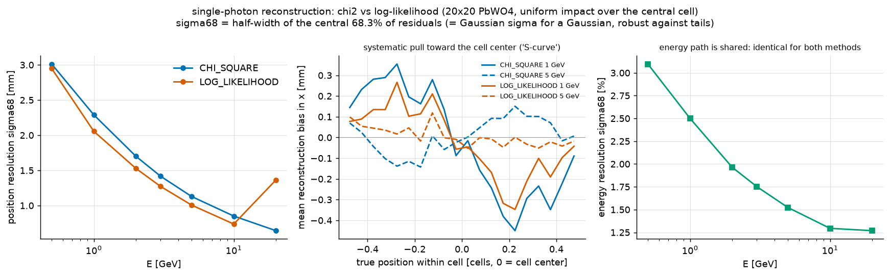

# The χ² position fit

The historic (default) single-shower fit. Given a cluster's cells, it
produces the shower's energy, position, and a fit quality — all against the
[measured transverse shower profile](./profiles).

## Energy: first moments + containment correction

The energy starts as the plain sum of the cluster's cells, and the first
moments (energy-weighted mean column/row) give the starting position. The
sum misses whatever leaked outside the cluster — below readout threshold,
into a beam hole, or off the calorimeter edge. The correction divides by
the *expected contained fraction*: the profile's mean fraction summed over
the cluster's cells **and** over the existing-but-silent neighbor cells,
evaluated at the moment position. The correction is clamped to [0.8, 1.0];
cells that do not physically exist (hole, edge — as declared by the cell
mask) are excluded from the sum, so their leakage is corrected *up*
instead of being treated as a measured zero.

The reconstructed energy is the same under both metrics — the
log-likelihood method deliberately keeps this energy path.

## Position: χ² minimization

For a hypothesized shower position, every cell is compared with the
profile expectation:

```
χ² = Σ_cells  (f_measured − f_expected(dx, dy))² / σ²(dx, dy, E)
```

where `f` are energy fractions, and the sum runs over the cluster's cells
*and* the silent neighbors (a silent cell next to a hypothesized shower
core is powerful evidence against that hypothesis). The variance model is
parametrized from the profile's measured fraction variance plus
energy-dependent terms (photostatistics-like `1/√E` scaling and a noise
floor).

The minimization walks the position in 0.05-cell steps with a parabolic
refinement, starting from the moments position. The reported `chi2` is
per degree of freedom (cells + silent neighbors − 2).

## Behavior and limitations

- **S-curve bias.** The energy-weighted starting position is biased toward
  cell centers; the χ² descent removes most but not all of it. The
  residual systematic reaches ~0.3–0.5 mm at 1 GeV for showers hitting
  mid-way between center and edge of a cell (2.05 cm PbWO₄).
- **Mean-and-variance summary.** The χ² sees only the first two moments of
  the cell response distribution. Real fraction distributions are strongly
  non-Gaussian (asymmetric near the core, exponential-like far from it) —
  this information is what the [log-likelihood method](./log-likelihood)
  adds, and where its resolution gain comes from.
- **Robustness.** The variance model makes the χ² tolerant of inputs that
  are not single showers — useful when fitting the *shared* cells of a
  multi-peak cluster, where it remains the fitting metric even under the
  log-likelihood configuration.



*Single-photon position resolution and mid-cell bias of the χ² fit (blue)
against the log-likelihood fit (orange); energy reconstruction (right
panel) is identical by construction. 20×20 PbWO₄ simulation with full
response chain. σ68 = half-width of the central 68 % of residuals.*
