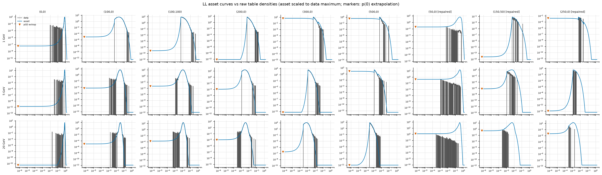

# Generating log-likelihood tables

How the binary table asset consumed by the
[log-likelihood method](./log-likelihood) is produced. The asset ships
separately from the library (~1 GB for seven energies) because it is
detector- and response-specific; regenerate it for any calorimeter the
shipped one does not describe — the same triggers as for
[shower profiles](./generating-profiles), plus any change of the readout
threshold, which sets the zero-signal probability.

## The chain

Four stages. Stages 1–3 are the production; stage 4 turns raw histograms
into the evaluator's input.

1. **Simulate.** Fixed-energy single-particle runs with the gun aimed at a
   *fixed point*, scanned over a fine impact grid covering one octant of a
   cell (1326 points at 0.01-cell steps — the symmetry of a square cell
   makes the rest redundant). Full response chain including smearing and
   the readout threshold. Repeat per energy: the distributions are strongly
   energy dependent, which is why the asset holds one table per energy.
2. **Fill.** Each run's hits become a sparse per-impact histogram of the
   collected fraction `f = e_vis / E_incident`, one histogram per cell
   offset node, with zero-signal cells counted separately
   (`python -m g4cal.llprof fill`).
3. **Merge.** The partials of one energy are summed into a dense table
   over all 125 751 offset nodes (`python -m g4cal.llprof merge`), one
   file per energy.
4. **Prepare.** The preparation script turns each table into the negative
   log-likelihood curves the library evaluates, and writes the single
   binary `ILLLPROF` asset loaded by `ilreco_config_load_ll_profiles()` /
   `ll_profiles=`.

Statistics: the tables above were made with 100 k events per impact point
(≈ 130 M events per energy), giving ≥ 100 k samples per node. That is a
farm-scale job — a few hundred thousand core-hours for the full seven
energies.

## What the preparation does

Per node and energy the asset stores `nll(f) = -ln(p(f)/pmax)` on a shared
log-`f` bin grid, plus `nll(0)` for cells that recorded nothing:

1. **Crack repair.** Nodes whose offset is 50 mod 100 are fed only by
   impacts aimed exactly at the inter-crystal gap, where an ideal,
   perfectly perpendicular point gun travels the full crystal length inside
   the wrap gap and mostly fails to convert. Those nodes carry no usable
   statistics and are replaced by neighbor-node averages.
2. **Smoothing.** A narrow Gaussian kernel over the raw counts, so
   thin-statistics bins do not produce jagged likelihoods.
3. **Tail model.** For the rapidly falling distributions of off-core nodes,
   an exponential with `lambda = <f>` of the nonzero samples fills bins
   with too few entries; near-core (peaked) nodes instead extend
   `ln p(f)` linearly on both sides of the well-populated support.
4. **The zero bin.** A zero cell is a *censored* observation — "somewhere
   below the readout threshold" — so its likelihood is the measured zero
   probability spread over the censored interval:
   `nll(0) = -ln((p0 / f_thr) / pmax)`, `f_thr = threshold / E`.
   Extrapolating the density to `f = 0` instead is unstable exactly where
   the histogram's support edge *is* the threshold, and produced a
   half-cell position bias when tried.
5. **Quantization.** `nll` clipped to [0, 32] and stored as uint16
   (≈ 5·10⁻⁴ resolution), `nll(0)` as float32.

*Prepared likelihood curves (line) over the raw per-bin densities (steps),
including repaired crack nodes (right columns). The flat continuation below
the data's lower edge is the deliberate extrapolation beneath the readout
threshold.*

## Pitfalls

- **Never ship a table with missing nodes.** An empty node evaluates as
  "no information" (`nll = 0`), which makes hole patterns *attractive* to
  the position fit. If a production is incomplete for one energy, leave
  that energy out of the asset entirely — clusters then fall back to the
  nearest complete table in log-energy, which costs far less than a holey
  table.
- **Check the zero probability per node** against an independent
  simulation: it is the quantity most sensitive to the readout threshold,
  and the one that most strongly drives the fit.
- **Verify before trusting**: reconstruct single showers with the new
  asset and confirm the position S-curve is smooth — a jagged or
  half-cell-periodic bias is the signature of a node-level preparation
  problem, not of the method.
