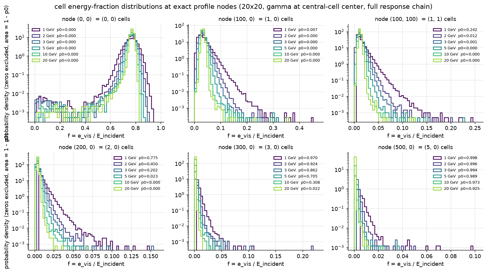

# The log-likelihood method

The historic position fit and cluster separation minimize a profile χ²: each
cell's measured energy fraction is compared to the *mean* fraction a shower
at the hypothesized position would deposit, weighted by a parametrized
variance. The log-likelihood (LL) method replaces this metric with the full
tabulated probability distribution of the fraction — instead of asking "how
far is this cell from the mean profile", it asks "how *probable* is this
cell's content for a shower at this position".

```python
import ilreco
calo = ilreco.Calorimeter(
    20, 20, profile="pwo",
    method="log_likelihood",
    ll_profiles="llprof_asset.bin",   # per-energy tables, see below
    split=True)                       # optional two-gamma separation
```

The cluster **energy** is unchanged — it stays the containment-corrected
moments estimate of the χ² path (by design; refining the energy by
likelihood maximization is a possible later extension).

## The tabulated distributions

For a photon hitting the calorimeter at a known point, the quantity
tabulated is the fraction `f = e_vis / E_incident` a cell collects, as a
function of the cell's offset from the impact point. Offsets are measured
in 0.01-cell steps; cells are square, so distributions are symmetric under
sign flips and axis swaps, and each offset is stored once as
`(offset_major, offset_minor)` with `minor <= major <= 500` — 125 751 nodes.
Cells below the readout sparsification threshold record `f = 0`; that
probability is tracked separately.



*Measured `f` distributions at six offset nodes, 1–20 GeV. Near the shower
center the distribution is a narrow peak; away from it, a rapidly falling
near-exponential from `f = 0`. Both the shapes and the zero-probability `p0`
depend strongly on energy — hence per-energy tables, with the table nearest
in log-energy chosen per cluster.*

## From histograms to the likelihood

Per node and energy the asset stores `nll(f) = -ln(p(f) / pmax)` on a
shared log-`f` bin grid, where `p` is the probability *density* of `f` and
`pmax` its maximum — plus `nll(0)`, the value used for cells that recorded
nothing. The preparation (Python, `830_llprof_asset.py` in the study
workspace):

1. **crack repair** — nodes whose offset is 50 mod 100 come only from
   simulation impacts aimed exactly at the inter-crystal gap, where an
   ideal, perfectly perpendicular point gun flies down the wrap gap and
   deposits almost nothing; they are replaced by neighbor-node averages;
2. **smoothing** — a narrow Gaussian kernel over the raw counts;
3. **exponential tails** (falling nodes) — `lambda = <f_nonzero>` defines
   `dens(f) = (1-p0) exp(-f/lambda)/lambda`, used wherever the histogram
   has too few entries and for the `f -> 0` extrapolation; "peaked"
   (near-center) nodes instead extend `ln dens` linearly in `f` on both
   sides of the well-populated support;
4. **`nll(0)`** — a zero cell is a *censored* observation ("below the
   sparsification threshold"), so its probability is the measured zero
   mass spread over the censored interval:
   `nll(0) = -ln((p0 / f_thr) / pmax)` with `f_thr = threshold / E`
   (density extrapolation to `f = 0` proved unstable where the histogram
   support edge is the threshold itself);
5. **quantization** — `nll` clipped to [0, 32], stored as uint16.


*Prepared likelihood curves (line) over the raw per-bin densities (steps) —
including repaired crack nodes (right columns). The flat continuation below
the data's lower edge is the deliberate extrapolation beneath the
sparsification threshold.*

## Position fit

The likelihood of a position hypothesis is the sum of `nll` over the
cluster's cells (`f = e_cell / E_cluster`) and over the zero-signal
neighbor cells (`nll(0)`), with every offset rounded to the nearest table
node. The fit is a coarse-to-fine descent on the 0.01-cell node grid
(steps of 5, 2, 1 nodes); the final position is the likelihood-weighted
average of the best four nodes of the final 3×3 neighborhood. The
`chi2` field of the output carries `nll / ndof` for this method.

## Two-gamma separation

With `split=True`, a single-peak cluster whose per-dof metric is poor is
tested against a two-shower hypothesis (both methods use the same
machinery, differing only in the metric):

1. first and second moments of the cluster give the principal axis;
2. scanning the energy asymmetry `a = (E1-E2)/E` seeds the pair — the
   second moment fixes the separation via `lam = E1 E2 / E^2 * d^2`;
3. coordinate descent refines the two positions;
4. the split is accepted if the per-dof metric improves by more than
   `split_threshold` **and** the pair passes the invariant-mass
   physicality cut (`zcal`-dependent, as in the historic code).

For the χ² metric each cell is compared to the sum of both predicted
showers with a combined variance. For the LL metric each cell is scored
once, against the shower predicting the larger share, after subtracting
the other shower's predicted contribution.

## Generating the tables

The asset ships separately from the library (it is ~1 GB for 7 energies).
The generation chain (see the study workspace for the concrete scripts):

1. **simulate**: fixed-energy photon point-gun runs on a fine impact grid
   covering one cell octant (1326 impacts at 0.01-cell steps), full
   response chain with smearing and sparsification;
2. **fill**: each run's hits become a sparse per-impact histogram partial
   (`g4cal.llprof fill`);
3. **merge**: partials of one energy combine into a dense per-node table
   (`g4cal.llprof merge`), one npz per energy;
4. **prepare**: `830_llprof_asset.py` applies the steps above and writes
   the single binary `ILLLPROF` asset consumed by
   `ilreco_config_load_ll_profiles()` / `ll_profiles=`.

Repeat with your own geometry and response model to produce tables for a
different calorimeter.

## Known limitations (v1)

- Table nodes at offsets ≡ 50 (mod 100) are neighbor interpolations
  (crack-impact artifact of the ideal training geometry).
- Overlapping showers are scored with the simpler per-peak assignment
  above; a joint two-shower likelihood is a recorded future improvement.
- Multi-peak clusters: the per-peak SHARED cell energies produced by the
  iterative profile sharing are deterministic profile fractions, not
  single-shower samples — the tables do not describe them, and a measured
  2x position degradation resulted. The LL method therefore falls back to
  the chi2-metric position fit for shared clusters (single-peak clusters,
  the vast majority, use the full LL fit). A proper joint likelihood for
  overlaps would supersede this.
- The energy is not likelihood-refined (kept from the moments estimate).
- `split_threshold` defaults to 0.5 per dof pending tuning on simulated
  two-photon samples.
- Table selection is nearest-in-log-energy; interpolating `nll` between
  the two bracketing energy tables is a recorded improvement for the
  tuning phase.
- A table with missing nodes (incomplete production) must not be shipped:
  empty nodes evaluate as "no information" (nll = 0), which makes hole
  patterns attractive to the position fit. Leave such an energy out of the
  asset — clusters fall back to the nearest complete table in log-energy —
  until the production is complete.
