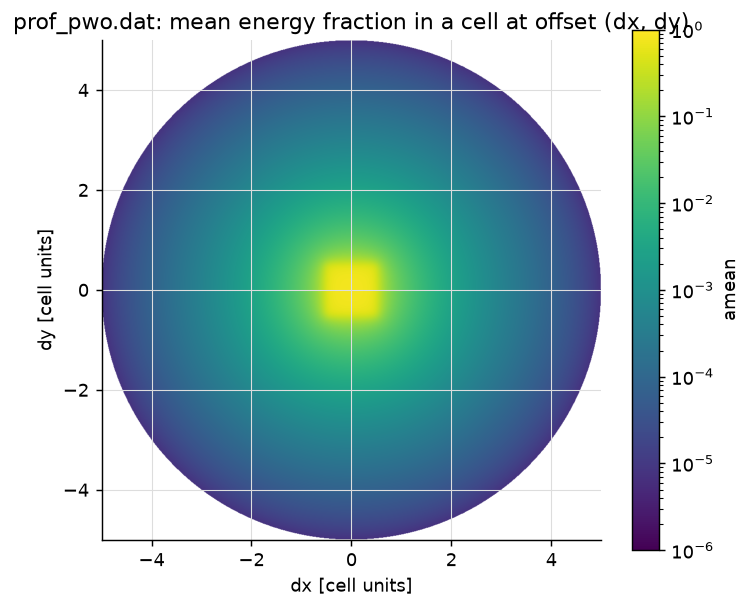
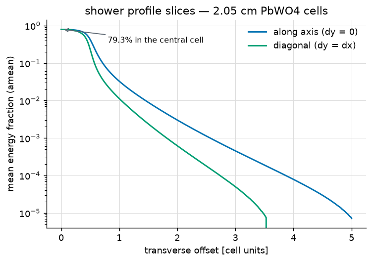
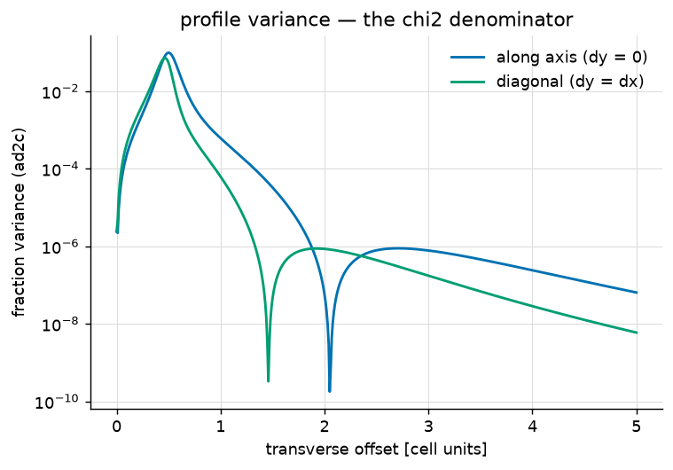

# The shower profile ("weights") file

The `.dat` file given to the config is the **transverse shower profile** of
your calorimeter. Energy sharing between overlapping showers, the
containment correction, and the [χ² position fit](./chi2-method) are all
computed against it.

## What it contains

For a shower axis at transverse offset `(dx, dy)` from a cell center (in
**cell units**), the table gives the *mean fraction* of the shower's energy
deposited in that cell (`amean`), and the *variance* of that fraction
(`ad2c`, the χ² denominator).

`prof_pwo.dat` says: a centered shower puts 79.3% of its energy in its own
2.05 cm PbWO4 cell, 3.3% in each side neighbor, 1.1% in a diagonal one —
falling six orders of magnitude within five cells:

The variance column drives how strongly each cell's deviation from the
expected fraction counts in the χ²:

## How the reconstruction uses it

- **Containment correction.** The expected fractions of the cluster's cells
  and of its existing-but-silent neighbors are summed at the moment
  position; the measured energy is divided by that sum. Cells that do not
  exist (beam hole, calorimeter edge) are excluded, so energy lost into
  them is corrected *up* rather than treated as a measured zero.
- **Position fit.** The χ² compares every cell's measured fraction with
  `amean` at the hypothesized offset, weighted by a variance model built
  on `ad2c`.
- **Energy sharing.** In a cluster with several maxima, each shower claims
  from every cell the fraction `amean` predicts for its position; cell
  energies are divided in proportion to those claims
  ([overlapping showers](./two-gamma)).

The table is defined on a grid of 0.01-cell offsets out to 5 cells, stored
as the symmetric triangle (125 751 nodes) and bilinearly interpolated
between nodes at run time.

Because offsets are in *cell units*, a table encodes the ratio of cell size
to Molière radius, the material, and the response chain of the setup it was
made for. Symptoms of using the wrong one: energy resolution far off
expectations, positions with a strong S-shape bias, χ² inflated for
perfectly clean single showers. Two tables ship with the library
(`prof_pwo.dat` for 2.05 cm PbWO₄, `prof_lg.dat` for lead glass); for any
other geometry see
[generating shower profiles](./generating-profiles).
