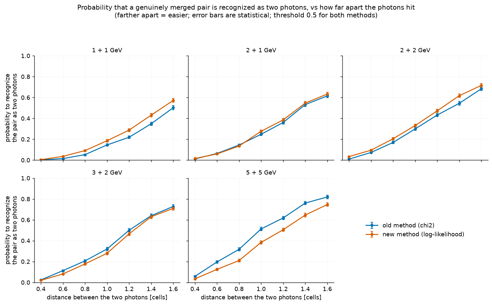
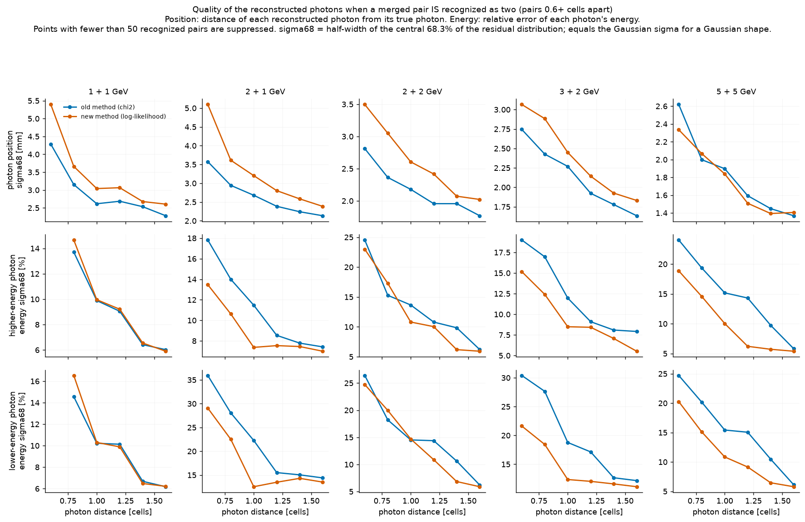

# Overlapping showers

A π⁰ above a few GeV decays into two photons that land within a cell or
two of each other. The calorimeter sees one island — sometimes with two
peaks, often with one. ilreco deals with the two cases at two different
stages.

## First order: an island with several peaks

When the [peak finder](./clustering) sees N > 1 maxima, the island's cells
are divided between the N shower candidates by **iterative profile
sharing**: each peak claims from every cell the fraction that a shower at
its position would deposit there, cell energies are split proportionally
to those claims, positions are re-estimated from the shares, and the loop
repeats (6 iterations). Each share is then fitted as a
[single shower](./chi2-method).

This stage runs identically under both metrics. Its shared cells are
deterministic fractions of the measured totals — not single-shower
samples — so the log-likelihood tables do not describe them; the position
fit of shared clusters therefore always uses the χ² metric.

## Second order: an island with ONE peak

The harder case: the photons are so close that their showers form a single
maximum. The second-order separation (off by default,
`split=True` / `ilreco_config_set_split`) tests every single-peak cluster
against a two-shower hypothesis:

1. **Seed from moments.** The cluster's second moments give the principal
   elongation axis; scanning the energy asymmetry `a = (E1−E2)/E` with the
   separation fixed by the second moment (`λ = E1E2/E² · d²`) seeds the
   two-shower configuration.
2. **Refine.** Both positions are refined by coordinate descent under the
   chosen metric — the χ² of the summed two-shower expectation (old
   method), or the per-cell log-likelihood with the partner shower's
   predicted contribution subtracted (new method).
3. **Accept** only if the per-degree-of-freedom metric improves by more
   than the configured threshold **and** the pair passes the invariant-mass
   physicality cut `√(E1E2)·d > m_cut(z_cal)` — a separation and energy
   sharing that no real π⁰ at the configured target distance could produce
   is rejected as a fluctuation.

The old method additionally *attempts* the separation only when the
single-shower χ²/ndof exceeds 3.0 (its historic pre-filter); the new
method tests every single-peak cluster and relies on the acceptance
threshold.

## Measured decision quality

Evaluated on genuinely merged pairs (overlaid simulated photons that
reconstruct as ONE cluster) versus single photons of the confusable total
energy — 20×20 PbWO₄, full response simulation:

*Probability to recognize a merged pair as two photons versus the distance
between the photons, for five energy combinations (threshold 0.5 for
both). Below ~0.5 cells the showers coincide and no method can separate
them.*

At the default threshold both methods recognize a similar fraction of
merged pairs, but the log-likelihood decision makes far fewer wrong splits
of single photons (≈ 0.01 % versus ≈ 0.15 %). Compared at the *same*
wrong-split rate — the fair comparison, since the two thresholds are not
on comparable scales — the log-likelihood method recognizes substantially
more merged pairs in every energy combination (e.g. 2+2 GeV pairs
0.6–1.2 cells apart: 48 % versus 24 %).

## Quality of the split

When a pair *is* recognized, each photon gets a position and an energy:

*Position and per-photon energy accuracy of recognized pairs versus photon
distance. The log-likelihood metric divides the cluster energy between the
photons markedly better (middle and bottom rows); the χ² metric keeps a
small edge on the positions of very close pairs.*

Dividing overlapping showers is intrinsically hard — per-photon energies
carry 10–30 % uncertainties in the merged regime under either metric. A
joint two-shower likelihood (fitting both photons against the tables
simultaneously instead of per-peak subtraction) is the planned next step
for both the positions and the energies.

## Tuning guidance

The acceptance threshold is the analysis knob: loosening it recognizes
more merged pairs at the cost of more wrongly split single photons. Choose
it from the wrong-split budget of your analysis (the fraction of fake
soft satellites you can tolerate), not by analogy between the two
methods' scales. Wrongly split singles are benign in shape: a highly
asymmetric pair ~1–2 cells apart whose leading fragment still carries the
true photon's position and most of its energy.
